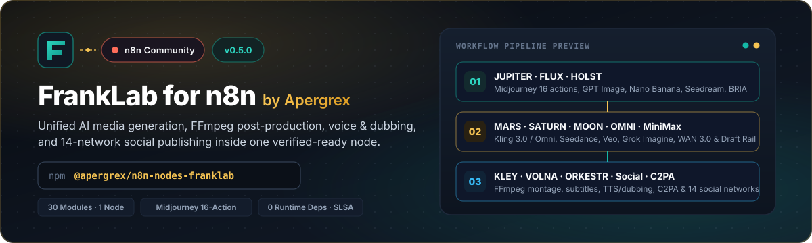

<div align="center">



<br />

[](https://www.npmjs.com/package/@apergrex/n8n-nodes-franklab)
[](https://github.com/d906090-rgb/n8n-nodes-franklab/actions/workflows/ci.yml)
[](https://www.npmjs.com/package/@apergrex/n8n-nodes-franklab)
[](./package.json)
[](./package.json)
[](./LICENSE)

**Official [Apergrex](https://apergrex.ru) / [FrankLab](https://franklab.ru) community node package for [n8n](https://n8n.io).**  
One unified node · **30 media & AI modules** · **0 runtime dependencies** · Server-side atomic billing · Signed SLSA provenance.

[Quick Start](#-60-second-quick-start) · [Capability Matrix](#-capability-matrix-30-resources) · [Starter Workflows](#-ready-to-import-starter-workflows) · [Operations Reference](#-operations-reference) · [Cookbook](https://franklab.ru/franklab/cookbook) · [Request API Key](#-api-key-and-price-list)

</div>

---

## Overview

**`@apergrex/n8n-nodes-franklab`** connects your n8n workflows to the first-party **Apergrex / FrankLab** media automation platform (`https://apergrex.ru/franklab/api` and `https://franklab.ru/franklab/api`) for AI image generation, cinema-grade video synthesis, FFmpeg post-production, speech/music/dubbing, C2PA Content Credentials, and 14-network social publishing.

### Why Teams Use FrankLab in n8n

- **Single Unified `FrankLab` Node** (`@apergrex/n8n-nodes-franklab.frankLab`) — all **30 modules** live cleanly under `Resource → Operation` with context-aware fields and built-in `Wait for Completion` polling (including two-step Midjourney `MODAL` pause states).
- **Zero Vendor Key Sprawl** — authenticate once with a single `FrankLab API` key; server-side atomic `reserve → confirm / refund` billing reports exact `final_cost_franks` per task.
- **Economy Pool (`economy_rail`) Draft Routing** — switch supported `JUPITER`, `MARS`, `SATURN`, and `Hot Coffee` tasks between the primary route and the low-cost corporate draft pool with a single dropdown.
- **Hardened for Verification** — `0` runtime dependencies, strict public `http(s)` SSRF guards, structured `NodeApiError` diagnostics, and GitHub Actions SLSA provenance verified by `@n8n/scan-community-package`.

---

## ⚡ 60-Second Quick Start

### 1. Install in n8n

Open **Settings → Community nodes → Install** in your n8n instance and enter:

```text
@apergrex/n8n-nodes-franklab
```

*(New to community nodes? See the official [n8n community node installation guide](https://docs.n8n.io/integrations/community-nodes/installation/).)*

### 2. Configure Credentials

Create a **FrankLab API** credential with two fields:

| Field | Value |
| :--- | :--- |
| **API Key** | Your partner API key (see [API Key And Price List](#-api-key-and-price-list)) |
| **Base URL** | `https://apergrex.ru/franklab/api` *(default)* or `https://franklab.ru/franklab/api` |

> The public package enforces first-party production origins only and rejects custom hosts, `localhost`, loopback/link-local IPs, metadata endpoints, and local file paths.

### 3. Drop the `FrankLab` Node Into Your Canvas

Add **FrankLab**, pick any **Resource** (e.g., `JUPITER`, `MARS`, `KLEY`, `VOLNA`, `Social`), choose an **Operation**, and enable **Wait for Completion** when you want automatic async task polling in a single step.

---

## 🧩 Capability Matrix (30 Resources)

| Domain | Resources | Flagship Capabilities |
| :--- | :--- | :--- |
| **Image Generation & Editing** | `JUPITER`, `FLUX`, `HOLST`, `Alibaba` | Full **16-action Midjourney** contour (`imagine`, `blend`, `describe`, `edits`, `upscale`, `variation`, `high-variation`, `low-variation`, `reroll`, `zoom`, `pan`, `inpaint` → `modal`, `remix-strong`, `remix-subtle`, `video`), GPT Image / Codex, Nano Banana / Gemini, Seedream, FLUX 3 Image/Klein, Qwen Image, Recraft, and 20+ `HOLST` / BRIA studio image tools |
| **AI Cinema & Video** | `MARS`, `SATURN`, `MOON`, `OMNI`, `Hot Coffee`, `MiniMax`, `X` | Kling 3.0 (`MARS`) & Kling 3.0 Omni (`SATURN`), BytePlus Seedance (`MOON` / `Hot Coffee`), Google Gemini Omni & Veo 3 (`OMNI`), MiniMax H3, xAI Grok Imagine (`X`), Alibaba HappyHorse & WAN 3.0, plus `Economy Pool (Draft)` routing |
| **Voice, Music, Dubbing & LLM** | `VOLNA`, `ORKESTR`, `NEPTUNE`, `PLUTO`, `DOLA` | ElevenLabs v4, Gemini 3.8 TTS, Seed Audio, Grok TTS/STT, voice cloning/design & dubbing (`VOLNA`), Suno v1/v2 + Google Lyria music (`ORKESTR`), video-synced foley (`PLUTO`), and MOON GPT structured JSON (`DOLA`) |
| **FFmpeg Montage & Captions** | `KLEY`, `PLASTINKA`, `SUFLER`, `TextSticker`, `Narezka`, `VariantPack` | Hardware-pinned FFmpeg 8.1.2 stabilization, split-screen, slow-mo, HDR→SDR, ProRes/DNxHR, chroma key & BRIA video BG (`KLEY`), EBU R128 loudness & audio samples (`PLASTINKA`), burned-in styled captions (`SUFLER`), vertical smart clipping (`Narezka`), and 2–100 unique ad variants (`VariantPack`) |
| **Avatars & Multi-Element** | `HeyGen Agent`, `VENUS`, `MERCURY`, `KUSOK`, `TITAN`, `ARIES` | Prompt-to-avatar Video Agent (`HeyGen Agent`), talking-portrait synthesis (`VENUS`), lip-sync (`MERCURY`), reusable character/voice libraries & Moon H5 verification (`KUSOK`), staged multi-element composition (`TITAN`), and historical try-on status (`ARIES`) |
| **Social Publishing & Trust** | `Social`, `C2PA` | Schedule, pre-moderate, multipost, and read analytics across **14 social platforms** (`YouTube`, `Instagram`, `TikTok`, `Telegram`, `VK`, `Facebook`, `Threads`, `Pinterest`, `LinkedIn`, `Bluesky`, `WordPress`, `OK`, `Yandex Zen`, `MAX`) + synchronous free **C2PA Content Credentials** verification & signing profiles |

---

## 🚀 Ready-to-Import Starter Workflows

Download any template from [`examples/`](./examples) and import it into n8n via **Workflows → Import from File**:

| Workflow Template | Resources Used | What It Automates |
| :--- | :--- | :--- |
| [`midjourney-imagine-upscale-video.workflow.json`](./examples/midjourney-imagine-upscale-video.workflow.json) | `JUPITER` | Generates a 16:9 Midjourney v8.2 grid (`imagine`), upscales tile `U1` (`upscale`), and animates it into an MP4 (`midjourneyVideo`) |
| [`ugc-product-reels-pipeline.workflow.json`](./examples/ugc-product-reels-pipeline.workflow.json) | `MARS` → `KLEY` | Synthesizes a 9:16 commercial product video in Kling 3.0 and normalizes final delivery geometry to `1080×1920` |
| [`ai-voiceover-video-assembly.workflow.json`](./examples/ai-voiceover-video-assembly.workflow.json) | `VOLNA` → `PLASTINKA` | Generates expressive neural voiceover audio and mixes/fits the track onto a target video |
| [`seedance-carousel-to-video.workflow.json`](./examples/seedance-carousel-to-video.workflow.json) | `JUPITER` → `Hot Coffee` | Creates a product keyframe image and animates it into a Seedance motion clip |
| [`moon-text-to-video.workflow.json`](./examples/moon-text-to-video.workflow.json) | `MOON` | Single-node cinematic text-to-video generation with built-in completion polling |
| [`saturn-turbo-video.workflow.json`](./examples/saturn-turbo-video.workflow.json) | `SATURN` | Fast Kling 3.0 Turbo text-to-video generation for rapid social story iteration |
| [`holst-image-info.workflow.json`](./examples/holst-image-info.workflow.json) | `HOLST` | Inspects remote image metadata and dimensions for pre-flight pipeline routing |

For full field-by-field recipes (with a Make.com ↔ n8n switcher), open the **[FrankLab Cookbook](https://franklab.ru/franklab/cookbook)**.

---

## 🔑 API Key And Price List

You need a FrankLab API key before these nodes can run jobs. To request an API key, current pricing, and onboarding details, contact:

- **Email:** `fedorchuk.a@apergrex.com`
- **Telegram:** `@ReanimatorXP`

Please mention that you want to use `@apergrex/n8n-nodes-franklab` in n8n. FrankLab will provide your API key and current commercial price list.

### How Server-Side Billing Works

The n8n package never calculates prices, holds balances, or stores billing logic locally:

1. n8n sends your API key over HTTPS with each request.
2. FrankLab authenticates the partner/workspace and enforces rate, model, and balance limits.
3. FrankLab atomically reserves funds before upstream execution and confirms or refunds on terminal state.
4. Supported responses return transparent cost telemetry: `final_cost_franks`, `cost_currency`, `cost_status`, and `cost_unit`.

---

## 📚 What This Package Contains

This repository is the **public n8n connector package only**:

- A single unified **FrankLab** action node (`@apergrex/n8n-nodes-franklab.frankLab`) exposing all 30 modules as top-level `Resource` options (`HOLST`, `KLEY`, `PLASTINKA`, `VOLNA`, `C2PA`, `SUFLER`, `TextSticker`, `ORKESTR`, `JUPITER`, `MARS`, `SATURN`, `MOON`, `VENUS`, `X`, `MiniMax`, `DOLA`, `Alibaba`, `OMNI`, `KUSOK`, `MERCURY`, `NEPTUNE`, `PLUTO`, `ARIES`, `TITAN`, `Hot Coffee`, `Social`, `FLUX`, `Narezka`, `VariantPack`, and `HeyGen Agent`). Kling runs exclusively through `SATURN` (Kling 3.0 Omni) and `MARS` (Kling 3.0).
- `FrankLabApi` credential definition (`https://apergrex.ru/franklab/api` and `https://franklab.ru/franklab/api`).
- A lightweight HTTP client using n8n's built-in request helper and structured `NodeApiError` reporting.
- Unit/contract/security tests, starter workflows, and GitHub Actions workflows for community-node verification and SLSA provenance publishing.

It does **not** contain FrankLab backend source code, upstream provider integrations or keys, `.env` files, billing internals, partner-admin routes, database schemas, MCP servers, or private Make.com module sources.

---

## 🛠 Operations Reference

Expand any domain below for module-level operation details:

<details open>
<summary><strong>1. Image Generation &amp; Studio Processing (JUPITER · FLUX · HOLST · Alibaba)</strong></summary>

### JUPITER
- Generate images with `omniImage` (generate/edit modes, quality, output format, aspect ratio, series), Google Gemini / Nano Banana (`geminiImage`), GPT Image 2 / Codex (`gptImageCodex`), Seedream (`seedreamImage`), or the full **16-action Midjourney** contour (`imagine`, `blend`, `describe`, `edits`, `upscale`, `variation`, `high-variation`, `low-variation`, `reroll`, `zoom`, `pan`, `inpaint`, `modal`, `video`, `remix-strong`, `remix-subtle`) plus Midjourney image-to-video (`midjourneyVideo`).
- Optional `Economy Pool (Draft)` (`economy_rail`) execution route on `omniImage`, `seedreamImage`, and `geminiImage` (also available on `MARS` text/image-to-video, `SATURN` video/turbo, and `Hot Coffee` `createVideo`).
- Recraft tasks (`recraftImage` + status) and legacy Youchuan Midjourney endpoints preserved for backward compatibility.
- Per-endpoint status polling returning `grid_image_url`, `images`, `videos`, `prompts`, `buttons`, and two-step `modal_ready` (`modal`) states.

### FLUX
- Generate, edit, continue, and draft-enhance FLUX 3 Video (`t2v`, `i2v`, `v2v`, `draft_enhance`, `edit`) and FLUX 3 Image / Klein tasks with pre-run quotes, availability probes, and status polling.

### HOLST
- Submit and poll studio image processing jobs: resize, crop, format conversion, watermark, image overlay, text, filters, rotate, flip, blur, sharpen, mask, metadata read/write, collage, adjust, GPS metadata removal, and BRIA operations (remove/replace background, erase foreground, erase by text, product lifestyle by text, product cutout).

### Alibaba
- Generate images with Alibaba Z-Image (synchronous), Qwen Image 3.0 / Pro (`Text to Image` & `Image Edit` with 1–3 stored-file IDs), and WAN 2.7 Image Pro.
- Submit HappyHorse 1.1 and WAN 3.0 Video tasks (text/image/reference/keyframe/edit/extend) with pre-run cost estimation, audio/watermark/prompt-extension toggles, and status polling.

</details>

<details>
<summary><strong>2. AI Cinema &amp; Video Synthesis (MARS · SATURN · MOON · OMNI · Hot Coffee · MiniMax · X)</strong></summary>

### MARS
- Kling 3.0 text-to-video and image-to-video (with optional `Economy Pool (Draft)` route), video effects (`effect_scene`, `effect`, `image`, optional `image_tail`), motion control (reference frame + video + duration), and status polling.

### SATURN
- SATURN (Kling 3.0 Omni) video generation, SATURN Turbo text/image-to-video, video extend (`/v1/videos/video-extend`), and multi-image-to-video (`/v1/videos/multi-image2video`) with per-endpoint polling.

### MOON
- Submit cinematic BytePlus Seedance video tasks (text/image/reference-to-video, video edit/extend) with model, duration, ratio, and resolution presets, pre-run cost estimates, and task polling.

### OMNI
- Google-backed video generation (Gemini Omni Flash 1.1 / 1.2, Veo 3 / Veo 3 Fast): text/image/reference-to-video, edit/extend, quotes, batch creation & batch polling (`partial_success`-aware), plus Google subscription rails (`videos/google-sub`, `images/google-sub`).

### Hot Coffee
- Generate images and Seedance videos (`createVideo` with optional `economy_rail` draft route) with operation, model variant, resolution, duration, and ratio presets plus per-surface status polling.

### MiniMax
- Submit MiniMax H3 video tasks with idempotency keys, scenario, resolution, duration, ratio, and stored-file first frames; mint idempotency keys, list paginated tasks, and cancel/delete tasks.

### X
- Generate videos (text/reference/edit/extend/single-image) and images with xAI Grok Imagine plus per-endpoint task status polling.

</details>

<details>
<summary><strong>3. Voice, Music, Dubbing &amp; Text (VOLNA · ORKESTR · NEPTUNE · PLUTO · DOLA)</strong></summary>

### VOLNA
- Text-to-speech, dialogue TTS, turbo TTS, ElevenLabs v4 / v4 Turbo, Google Gemini 3.1 & 3.8 TTS, BytePlus Seed Audio 1.0, xAI Grok TTS/STT, Google Gemini 3.5 STT, sound effects, audio isolation, voice clone, voice design, dubbing, and voice/model/usage lookups.

### ORKESTR
- V1 (Suno envelope) and V2 (`Wait for Completion`-capable): music generation, extend, upload cover/extend, add instrumental/vocals, replace section, mashup, lyrics & timestamped lyrics, vocal separation, MIDI & WAV conversion, music video, cover image, style boost, persona, and Google Lyria music.

### NEPTUNE
- Generate speech from text with optional voice/model selection, voice list lookup, and status polling.

### PLUTO
- Generate standalone audio from text prompts or video-synced foley/soundtracks for existing videos with status polling.

### DOLA
- Generate text and structured JSON (`json_object` / `json_schema`) with MOON GPT models, poll async billing task IDs, import files from public URLs, and list/get/delete files and models.

</details>

<details>
<summary><strong>4. FFmpeg Post-Production, Captions &amp; Variants (KLEY · PLASTINKA · SUFLER · TextSticker · Narezka · VariantPack)</strong></summary>

### KLEY
- FFmpeg 8.1.2 montage operations: stabilize, scene list, QC report, split screen (2–4 sources), slow motion, denoise, HDR→SDR, animated loop (WebP/AVIF), mezzanine master (ProRes/DNxHR), round, background removal, chroma key, waveform, BRIA video replace-BG / erase-object, quality compare, speed changes, subtitle rendering, and overlays.

### PLASTINKA
- Audio post-production (EBU R128 loudness analysis, spectrogram, waveform image, Chromaprint fingerprint, dialogue enhancement, stereo tools, ALAC/Opus conversion, quality compare) plus reusable audio sample management (`save`, `list`, `applySample`).

### SUFLER
- Burn styled subtitles into video with the v1 or v2 caption engine, templates, language/transcription options, highlight modes, and platform safe-zone presets.

### TextSticker
- Overlay text, stickers, emojis, and images onto video, plus studio catalog lookups (fonts, stickers, emojis, subtitle templates, effects, transitions, safe zones, aspect ratios).

### Narezka
- Smart vertical clipping (`clips`) and highlight compilations (`compilation`) from long-form videos with cost estimation, source URL import, and `Idempotency-Key` protection.

### VariantPack
- Batch-generate 2–100 uniquely varied video copies with presets (`light`, `standard`, `stealth`, `speech`, `balanced`, `deep`, `custom`), AI captions, cost estimates, and brand/library pickers.

</details>

<details>
<summary><strong>5. Avatars, Libraries &amp; Composition (HeyGen Agent · VENUS · MERCURY · KUSOK · TITAN · ARIES)</strong></summary>

### HeyGen Agent
- Prompt-to-avatar video generation with 2-stage session→video polling, interactive Video Agent chat sessions, resource inspection, session stop, and pickers for saved credentials, avatar looks, voices, styles, brand kits, and glossaries.

### VENUS
- Generate talking-avatar videos from a portrait image plus an audio URL or audio ID with status polling.

### MERCURY
- Lip-sync video to speech audio (compat and advanced modes) and run face identification on images.

### KUSOK
- Reusable element library (`create`, `list`, `get`, `delete`), portrait recognition, voice library & presets, and Moon H5 verification / Seedance asset operations (`moonOperation`).

### TITAN
- Staged multi-element video composition (`initialize`, `add`, `delete`, `clear`, `preview`, `create`) with task list and status polling.

### ARIES
- Poll historical Kolors virtual try-on tasks (new submissions return `410 Gone` server-side).

</details>

<details>
<summary><strong>6. Omnichannel Social Publishing &amp; C2PA Credentials (Social · C2PA)</strong></summary>

### Social
- Publish, schedule, or pre-moderate posts across 14 social networks (`youtube`, `instagram`, `tiktok`, `facebook`, `threads`, `pinterest`, `telegram`, `vk`, `linkedin`, `bluesky`, `wordpress`, `ok`, `yandex_zen`, `max`), multipost with `Idempotency-Key`, manage releases (`list`, `get`, `edit`, `cancel`, `retry`, `delete`, `remote_edit`, `remote_delete`), and fetch analytics insights.

### C2PA
- Synchronously verify Content Credentials on any public HTTPS media URL (`Valid`, `Trusted`, `Invalid`, `Unknown`, `NoManifest` — free, stateless, zero storage) and manage self-signed C2PA signer profiles (`list`, `generate`, `revoke`).

</details>

---

## Usage Notes

- **URL-Only Media Policy:** Pass public `http` or `https` URLs (or partner-scoped stored file IDs where supported). Localhost, private/link-local IPs, cloud metadata endpoints, and local file paths are blocked client- and server-side.
- **Polling & Two-Step Modal Flows:** Enable `Wait for Completion` on async submit operations to receive the final asset automatically. For two-step Midjourney `inpaint`, the first node returns `status: "modal"` (`modal_ready: true`), allowing the next node to submit `modal` with your `mask_url` and `prompt`.
- **Advanced Parameters:** Use `Additional JSON` for optional long-tail fields. Never place secrets, PEM keys, or upstream credentials inside workflow fields.

---

## Development & Verification

This repository separates the zero-dependency published package from its `private: true` build/lint toolchain (`tooling/`), which is excluded from the npm tarball:

```bash
npm ci --ignore-scripts
npm run tooling:ci
npm run build
npm test
npm run scan
```

- **Compatibility:** Built with `@n8n/node-cli@0.46.2` on Node.js 24; supports `node >=20.19` and has `0` runtime dependencies.
- **Provenance & Scanner:** Published exclusively via GitHub Actions (`publish.yml`) from [`d906090-rgb/n8n-nodes-franklab`](https://github.com/d906090-rgb/n8n-nodes-franklab) with signed SLSA provenance and verified via `npm run scan:published` (`npx @n8n/scan-community-package @apergrex/n8n-nodes-franklab`).

---

## Resources

- [Apergrex Platform](https://apergrex.ru)
- [FrankLab Cookbook (n8n & Make.com Editions)](https://franklab.ru/franklab/cookbook)
- [npm Package (`@apergrex/n8n-nodes-franklab`)](https://www.npmjs.com/package/@apergrex/n8n-nodes-franklab)
- [n8n Community Nodes Documentation](https://docs.n8n.io/integrations/#community-nodes)

---

## Version History

- **`0.5.1`**: Translated remaining non-English source comments in `nodes/shared/registry.ts` and voiceover sample text in `examples/ai-voiceover-video-assembly.workflow.json` to English for n8n Verified Community Node compliance, and added a test guard enforcing English-only Latin script across repository and package files.
- **`0.5.0`**: Added the full 16-action Midjourney contour (`midjourneyImage`, `getMidjourneyImageStatus`, `midjourneyVideo`, `getMidjourneyVideoStatus`) on `JUPITER`, optional `Economy Pool (Draft)` (`economy_rail`) routing on `JUPITER`, `MARS`, `SATURN`, and `Hot Coffee` (`createVideo`), unshadowed `imageUrl`/`video_url`/`videos`/`prompts`/`buttons`/`modal_ready` extraction, `modal` terminal polling support, and `string[]` `image_urls` / `mask_url` SSRF validation.
- **`0.4.0`**: Consolidated all 30 modules into a single unified `FrankLab` action node (`Resource → Operation`) and wrapped HTTP/API errors in `NodeApiError` to satisfy n8n Verified Community Node review requirements.
- **`0.3.1`**: Organized operations under `Resource` groups across multi-operation modules and refined `VOLNA` labels for `@n8n/scan-community-package` zero-warning compliance.
- **`0.3.0`**: Make.com P0 parity wave (`Social`, `FLUX`, `Narezka`, `VariantPack`, `HeyGen Agent` + 8 module upgrades) and `https://apergrex.ru/franklab/api` production origin support.
- **`0.2.4`**: `Alibaba` WAN 3.0 / Qwen Image fields and synchronous `C2PA` `Verify Asset` operation.
- **`0.2.3`**: `KLEY` and `PLASTINKA` FFmpeg 8.1.2 post-production and EBU R128 analysis operations.
- **`0.2.0`**: Full Make-parity wave adding 20 generation and utility modules.
- **`0.1.0` – `0.1.2`**: Initial public scaffold (`HOLST`, `KLEY`, `PLASTINKA`, `VOLNA`, `C2PA`), metadata, and lint refinements.
